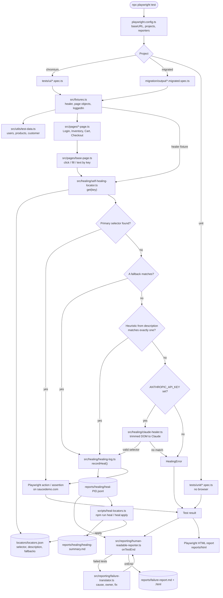
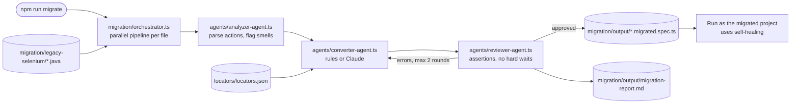
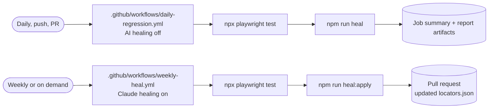

# Playwright AI Self-Healing Framework

A Playwright + TypeScript framework, demoed on [Sauce Demo](https://www.saucedemo.com), that shows three ideas I used to modernise a legacy Selenium suite:

1. **Multi-agent Selenium → Playwright migration** — Analyzer, Converter and Reviewer agents turn Java/TestNG tests into Playwright specs, in parallel.
2. **Self-healing locators** — a cheap-first ladder (fallbacks → heuristics → Claude API) keeps tests running when the UI changes, and a weekly or on-demand job promotes healed selectors back into the locator registry.
3. **Human-readable failure reports** — raw errors like `Timeout 5000ms exceeded`, `404` or `Received: []` become "what broke, likely cause, who should look, how to fix".

> In the production suite this approach was built for (≈300 UI tests), daily run stability went up by about 30% and execution time dropped from 1 h 45 min to about 1 h. This repo is a public, self-contained demo of the same techniques.

---

## Architecture

```
locators/locators.json        ← one registry: selector + description + fallbacks per element
src/
  healing/
    self-healing-locator.ts   ← primary → fallbacks → heuristics → Claude
    claude-healer.ts          ← asks Claude for a selector from a trimmed DOM
    healing-log.ts            ← every heal is logged (per worker, merge-safe)
  reporting/
    failure-translator.ts     ← rules: raw error → category, cause, owner, fix
    human-readable-reporter.ts← custom Playwright reporter (Markdown + HTML)
  pages/                      ← Page Objects built on the healer
  fixtures.ts                 ← typed fixtures (healer, pages, loggedIn)
tests/
  ui/                         ← Sauce Demo specs (login, inventory, cart, checkout, healing demo)
  unit/                       ← browser-free tests for the translator and heuristics
migration/
  legacy-selenium/*.java      ← sample legacy tests
  agents/                     ← Analyzer, Converter, Reviewer
  orchestrator.ts             ← runs the agent pipeline per file, in parallel
  output/                     ← generated Playwright specs + migration report
scripts/heal-locators.ts      ← weekly / on-demand registry update
.github/workflows/            ← daily regression + weekly Claude healing PR
```

### How a test run flows through the files



### How the migration produces the `migrated` tests



### Scheduled jobs



### Self-healing ladder

| Tier | When it runs | Cost |
|---|---|---|
| Primary selector | Always (waits up to 4 s for the page) | free |
| Known fallbacks | Primary missing | free, instant |
| Heuristics from the element's description (`data-test`, `id`, `name`, `placeholder`, `aria-label`) | No fallback matched; must match exactly one element | free, instant |
| **Claude API** with a trimmed DOM | Only if `ANTHROPIC_API_KEY` is set and `AI_HEALING` isn't `off` | 1 API call |

Every heal is written to `reports/healing/`. `npm run heal` summarises them; `npm run heal:apply` promotes the most frequent healed selector to primary and keeps the old one as a fallback. The **weekly workflow** runs the suite with Claude enabled, applies the heals and opens a pull request — so locators are fixed for good, not re-healed every day.

### Failure report

`reports/failure-report.html` and `.md` list each failure with the **business step** that failed (from `test.step` titles), a cause category, an owner (Test code / Application / Test data / Environment), expected vs received, and a suggested fix. Example:

```
✖ Cart › adding two products updates the badge and the cart
  Wrong value · owner: Application
  Step "Cart badge shows 2": the app showed a different value than expected.
  Fix: Compare expected vs received below; reproduce manually before changing the test.
```

### Migration agents

```
Analyzer  → parses @Test methods into actions, flags smells (Thread.sleep, absolute XPath)
Converter → writes a Playwright spec (rule-based, or Claude when a key is set)
Reviewer  → enforces rules (assertions present, no hard waits, no Selenium API)
            errors go back to the Converter (max 2 rounds), then fall back to rules
```

Known selectors are mapped to registry keys, so migrated tests get self-healing for free. Absolute XPaths are wrapped in the healer with a description instead of copied as-is.

---

## Getting started

```bash
npm ci
npx playwright install --with-deps chromium

npm test                 # all projects: UI, migrated, unit
npm run test:heal-demo   # watch locators heal from stale selectors
npm run heal             # summarise heals from the last run
npm run migrate          # re-run the Selenium → Playwright agents
npm run report           # open the Playwright HTML report
```

Optional: copy `.env.example` to `.env` (or export the variables) and set `ANTHROPIC_API_KEY` to enable the Claude tiers. Everything works without it.

For CI, add `ANTHROPIC_API_KEY` as a repository secret for the weekly healing job.

## Tech

Playwright Test · TypeScript · Anthropic SDK (Claude) · GitHub Actions

## License

MIT
